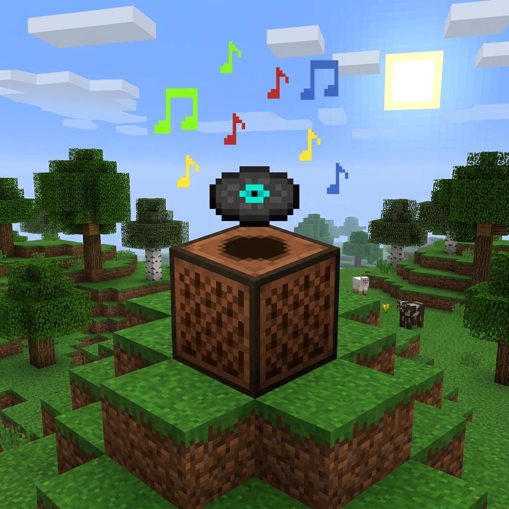

<div align="center">

# CloudJukebox
**Search and stream music from SoundCloud directly through Minecraft jukeboxes.**

<br>



<br><br>

[](https://minecraft.net/)
[](https://fabricmc.net/)
[](https://github.com/shushpaaaa/CloudJukebox/releases)
[](LICENSE)
[](https://adoptium.net/)

</div>

---

## Overview

**CloudJukebox** is a Fabric mod for Minecraft 1.21.1 that turns standard in-game jukeboxes into full-featured music players connected to SoundCloud.

No web browsers or third-party bots required—simply right-click any jukebox, search for an artist, track, or remix, and hit **Play**. Everyone nearby hears the same song in real time with authentic 3D spatial audio.

---

## Features

- **Direct SoundCloud Search:** Integrated in-game search engine with pagination, album artwork, and track duration tags.
- **3D Spatial Audio:** Sound radiates directly from the jukebox block with natural quadratic distance decay (up to 64 blocks) and directional stereo panning based on player head orientation.
- **Multiplayer Synchronized:** Music is synchronized between client and server so players hear the same stream at the same time.
- **Non-Overlapping Playback:** Starting a new song stops the previous jukebox across the world, ensuring clean playback without layered audio conflicts.
- **State Persistence:** Preserves your search text, search results, and selected page when opening and closing the interface.
- **Clean Vanilla Aesthetic:** 9-slice beveled container styling, smooth unblurred world darkening, and authentic particle feedback.
- **Fail-Safe Lifecycle:** Breaking the jukebox block by hand, explosion, or piston immediately cuts the audio line and frees system resources.
- **Vanilla Disc Compatibility:** Right-clicking with an actual music disc continues to play standard Minecraft records.

---

## Usage

1. Place down a vanilla **Jukebox**.
2. **Right-click** it with an empty hand (or crouch-right-click).
3. Enter any track or artist name into the search bar and press **Enter** (or click **Search**).
4. Select a song from the results list and click **▶ Play**.
5. Adjust volume with the on-screen volume toggle (`100%` → `80%` → `60%` → `40%` → `20%`) or your in-game sound settings.
6. Click **⏹ Stop** or break the jukebox block to end playback immediately.

---

## Installation

### Requirements
- **Minecraft:** `1.21.1`
- **Mod Loader:** [Fabric Loader](https://fabricmc.net/use/) (`>= 0.16.9`)
- **Dependencies:** [Fabric API](https://modrinth.com/mod/fabric-api)
- **Java:** `21` or newer

### Client & Server Setup
- **Singleplayer:** Place `cloudjukebox-1.0.0.jar` and `fabric-api.jar` into your `.minecraft/mods` folder.
- **Dedicated Server:** Install the mod on both the server and each connecting player's client.

---

## Building from Source

Clone the repository and build using the Gradle wrapper:

```bash
git clone https://github.com/shushpaaaa/CloudJukebox.git
cd CloudJukebox
./gradlew build
```

The compiled JAR will be located in `build/libs/cloudjukebox-1.0.0.jar`.

---

## License

This project is licensed under the [MIT License](LICENSE).
